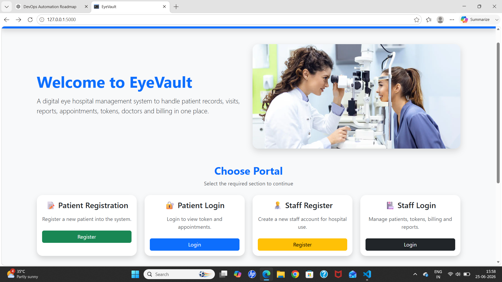
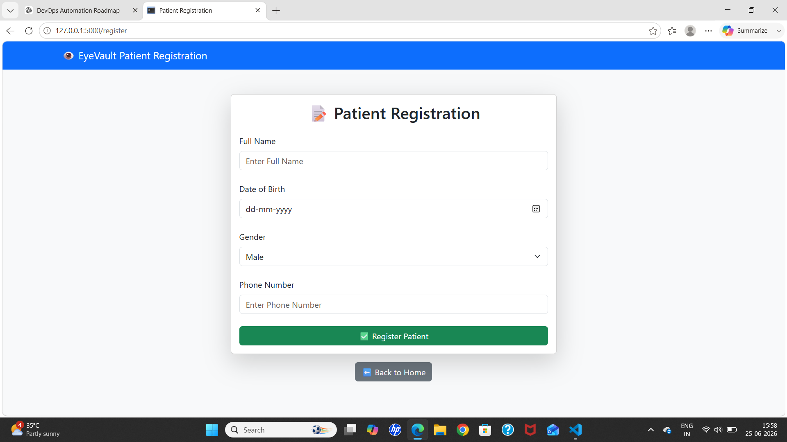
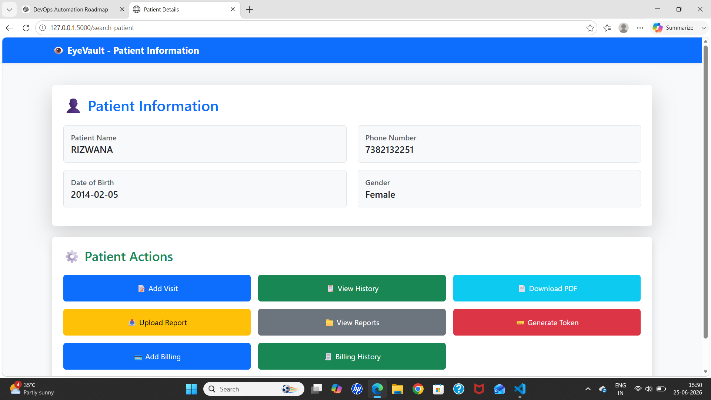
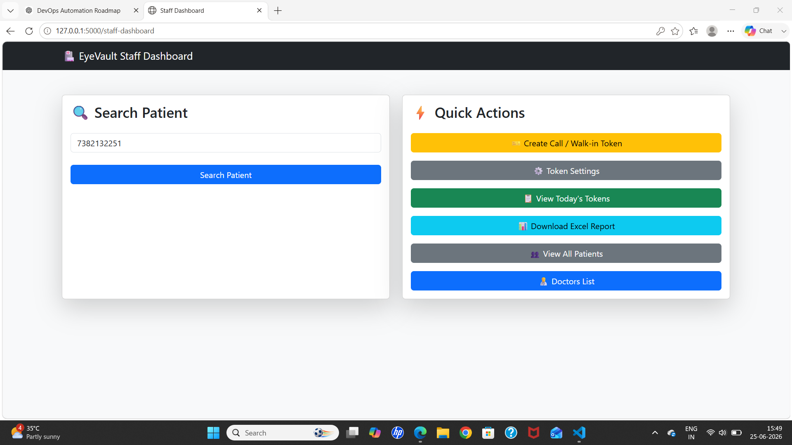
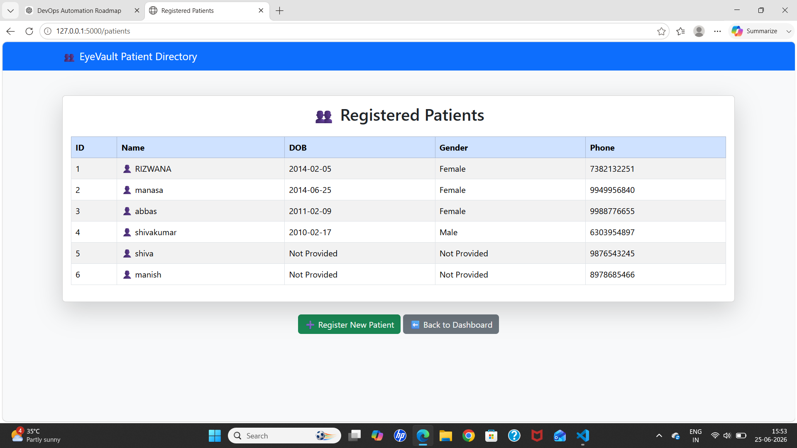
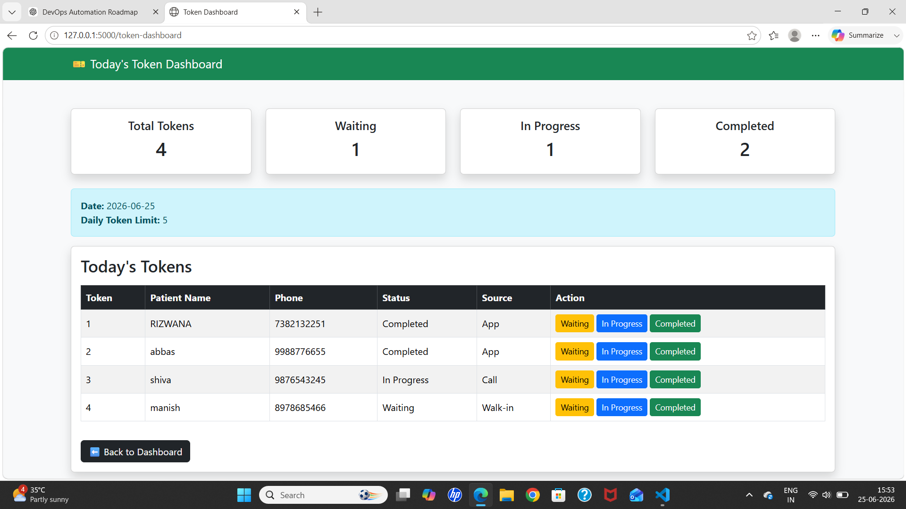
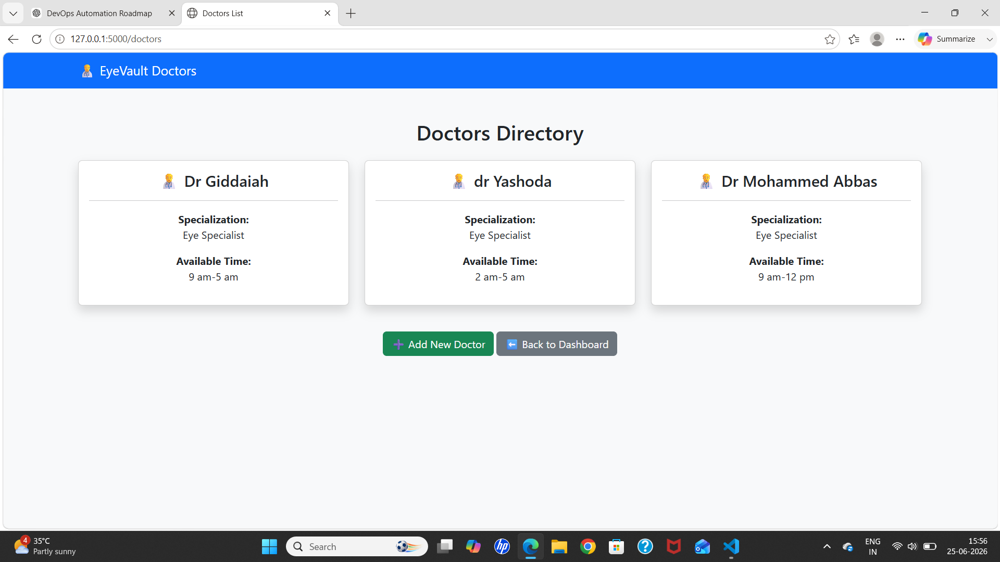
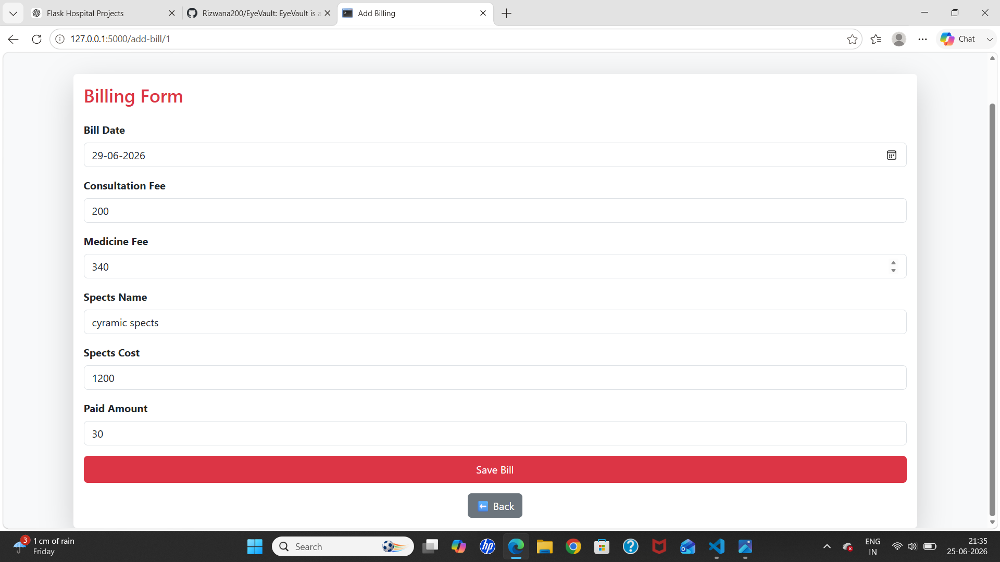
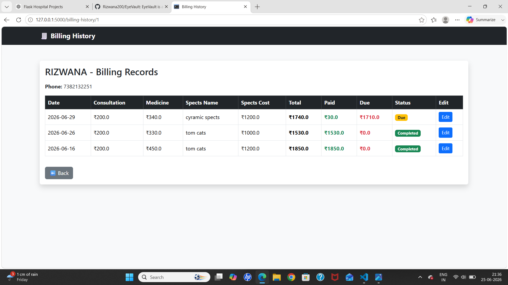

# 👁️ EyeVault

> **Your care, our vision.**

A Flask-based management system for a small eye clinic. It replaces paper registers and spreadsheets for patient records, daily queue tokens, visit history, reports, and billing.


---

## The problem

Small clinics often track patients, queue numbers, and payments by hand. That leads to lost reports, patients waiting without knowing their position, and bills where nobody is sure what is still unpaid.

EyeVault gives clinic staff one place to register patients, issue and track daily tokens, record visits, store reports, and manage bills. Patients get a dashboard showing their own token status, history, reports, and bills.

**Why I built it:** I wanted to take a real-world workflow, the daily running of a small clinic, and build it end to end myself, from database design to a Dockerized deployment.

**My contribution:** Solo project. I did the design, database schema, backend, templates, and Docker setup.

---

## Tech stack

| Layer | Choice |
|---|---|
| Language / framework | Python, Flask |
| Database / ORM | SQLite, Flask-SQLAlchemy |
| Frontend | Jinja2 templates, Bootstrap 5 |
| Exports | OpenPyXL (Excel), ReportLab (PDF) |
| Packaging | Docker |

---

## Features

**Patient side**
- Register and log in with a phone number
- Dashboard: personal details, today's token and queue status, visit history, reports, billing history
- Generate a token from the dashboard

**Staff side**
- Staff registration and login
- Search a patient by phone and open their record
- Add visit details (date, doctor, diagnosis, notes)
- Upload and view patient reports
- Manual token creation for walk-ins and phone bookings
- Live token dashboard (Waiting / In Progress / Completed) and a configurable daily token limit
- Manage doctors and spectacles catalogue
- Create and edit bills, and view billing history
- Export tokens to Excel and download a patient's visit history as PDF

---

## Architecture

EyeVault is a single Flask application. Routes in `app.py` query the database through SQLAlchemy models and render Jinja templates. There are no separate API services.

```
Browser (Bootstrap UI)
        │  HTTP (form posts and page requests)
        ▼
Flask routes (app.py)
        │  SQLAlchemy ORM
        ▼
SQLite (instance/database.db)        static/uploads/  ← patient report files
```

```
EyeVault/
├── app.py              # models, routes, business logic
├── templates/          # Jinja2 pages (patient, staff, token, billing)
├── static/             # CSS and uploaded reports
├── Dockerfile
├── requirements.txt
└── screenshots_eyevault/
```

---

## Data model

`Patient` is the central table. Visits, reports, tokens, and bills all link to it through `patient_id`.

```
Patient 1 ──< Visit
Patient 1 ──< Report
Patient 1 ──< Token
Patient 1 ──< Billing
```

| Table | Key columns | Purpose |
|---|---|---|
| **Patient** | `id` (PK), `name`, `dob`, `gender`, `phone` (unique) | Registered patients |
| **Staff** | `id` (PK), `name`, `phone` (unique), `password` | Clinic staff accounts |
| **Visit** | `id` (PK), `patient_id` (FK), `visit_date`, `doctor_name`, `diagnosis`, `notes` | Visit history |
| **Report** | `id` (PK), `patient_id` (FK), `file_name`, `upload_date` | Uploaded patient reports |
| **Token** | `id` (PK), `patient_id` (FK), `token_number`, `visit_date`, `status`, `source` | Daily queue tokens |
| **Billing** | `id` (PK), `patient_id` (FK), `bill_date`, `consultation_fee`, `medicine_fee`, `spect_name`, `spect_cost`, `total_amount`, `paid_amount`, `due_amount`, `payment_status` | Bills and payments |
| **Doctor** | `id` (PK), `name`, `specialization`, `available_time` | Doctors list |
| **Spect** | `id` (PK), `name`, `price` | Spectacles catalogue |
| **Settings** | `id` (PK), `max_tokens_per_day` | Daily token limit |

---

## Key design decisions

- **Phone number as the patient identifier.** It is unique in the database and is what front-desk staff already ask for.
- **Tokens are per day.** Each token stores a `visit_date`, and numbering restarts every day. A patient gets one token per day, and a configurable cap in `Settings` limits the day's total.
- **Billing is computed on the server.** Total is consultation + medicine + spectacles. Due is total minus paid, floored at zero. Status becomes `Completed` when due is zero, otherwise `Due`. Bills can be edited so partial payments can be settled later.
- **SQLite for simplicity.** It needs no setup and fits a single-clinic deployment. Moving to PostgreSQL would need only a connection-string change plus proper migrations.
- **Docker for repeatable setup.** The container gives the same environment on any machine.

---

## Testing

**Current status:** tested manually through the UI.

**Planned:** pytest coverage for token limits, billing calculation, and access control, run on every push with GitHub Actions.

```bash
pytest
```

---

## Getting started

### Run locally

```bash
git clone https://github.com/Rizwana200/EyeVault.git
cd EyeVault

python -m venv venv
# Windows
venv\Scripts\activate
# Mac / Linux
source venv/bin/activate

pip install -r requirements.txt
python app.py
```

Open http://127.0.0.1:5000/

The database is created automatically on first run. To create a staff account, use `/staff-register`.

### Run with Docker

```bash
docker build -t eyevault .
docker run -p 5000:5000 eyevault
```

Then open http://127.0.0.1:5000/

---

## Screenshots

### Home Page


---

### Patient Registration


---

### Patient Directory


---

### Staff Dashboard


---

### Patient Details


---

### Token Dashboard


---

### Doctors List


---

### Add Bill


---

### Bill History


---

## How I used AI while building this

I used AI tools as a pair-programming and review aid, mainly for debugging, reviewing my code, and structuring documentation. I did not paste suggestions in blindly. I read each one, checked it against how my code actually works, and ran it before keeping it.

---

## Author

**Rizwana** — [GitHub](https://github.com/Rizwana200)

---

## Our vision

> *Your care, our vision.*

> *Good software, like good eye care, works quietly so people can focus on what matters.*

> *Every patient seen, every token tracked, every record safe.*

> *Clear records. Shorter queues. Better care.*

⭐ If you find EyeVault useful, consider starring the repo.
